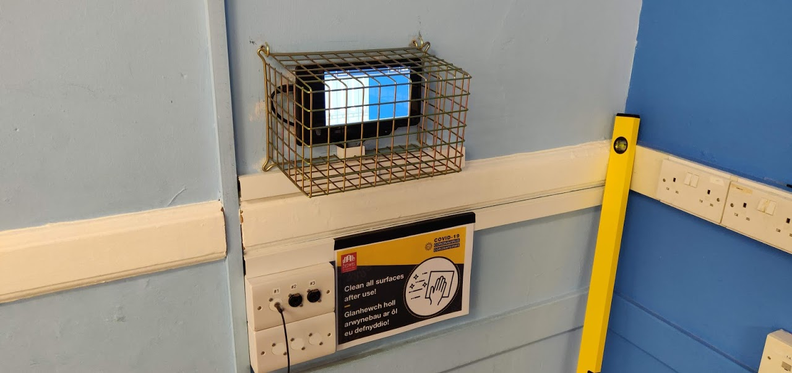

# TouchDesk

A simple, locked-down touchscreen remote for digital sound desks, running on a Raspberry Pi.

An installer sets the sound desk up properly (EQ, compression, gain and so on) and leaves the venue with a small wall-mounted screen showing just what they need: a fader and an ON/OFF button for each channel, a Mute All button, and Bluetooth music controls. It talks to the desk over the network using OSC, and the Pi can be powered over PoE, so the screen can sit anywhere a network cable reaches.



## What's new in version 2

TouchDesk 1.x ran 24/7 at a community venue from September 2020. Version 2 keeps the same screen and colours but rebuilds the inside:

- **Two-way sync.** The screen now shows what the desk is really doing. Changes made on the desk, in X AIR Edit or on a tablet appear on the touchscreen straight away, and everything is re-read whenever the desk reconnects or reboots.
- **Finds the desk by itself.** No more hard-coded IP address. A fixed address still works if you prefer.
- **Copes with the desk going away.** If the network drops, the screen says so and reconnects automatically.
- **Bluetooth can't stop it starting.** 1.x crashed at start-up if no phone was connected; now the player just says "No device connected".
- **Phones can't fill the Pi up.** It remembers at most 10 phones, forgetting the least recently used, and the installer settings have a "Forget phones" button.
- **Album artwork** in the Bluetooth player, sent by the phone itself (no internet needed). Not every phone or app sends it; when there's none, a music-note placeholder shows.
- **A settings file instead of editing code.** Number of channels, which desk channel each controls, names, PINs, timeouts, maximum level.
- **Installer settings on the touchscreen,** behind a separate installer PIN: find desk, PIN lock on/off, auto-lock time, change PINs, 0–10 or dB readouts, names from the desk.
- **Better PIN lock.** Digits are hidden as you type, and too many wrong guesses pause the keypad for a minute.
- **Mute All works even when the screen is locked,** so anyone can kill feedback.
- **Choose which four desk channels a screen controls,** so one desk can serve several rooms, each with its own screen, Bluetooth name and Mute All.
- **Desk profiles.** Behringer X Air (XR12/XR16/XR18) and Midas MR. Behringer X32 / Midas M32 is included but untested.
- **A TouchDesk icon on the desktop and taskbar**, so it can be restarted with one tap if it's ever closed. Only one copy can run at a time.
- **One-command install** on a fresh Raspberry Pi OS, with auto-start and automatic restart if anything goes wrong.
- **Modern Qt (PySide6)** and an automated test suite.

## Hardware

- Raspberry Pi 4 (2 GB is plenty) running the current **64-bit Raspberry Pi OS with desktop**.
- A touchscreen. The layout is designed for 800×480 and scales to larger screens.
- A network connection to the desk (wired recommended; PoE HAT optional).
- Optional: a 3.5 mm jack to the desk for Bluetooth audio.

## Installing

On the Pi, in a terminal:

```bash
git clone https://github.com/Gwalchgwyn/TouchDesk.git
cd TouchDesk
bash deploy/install.sh --room green --bluetooth    # leave off --bluetooth if you don't need it
```

### Rooms

One XR12 can serve two rooms, each with its own TouchDesk screen:

| Room | Option | Desk channels | Shows on phones as |
|---|---|---|---|
| Green Room (Room 1) | `--room green` | 1–4 (Aux 1) | Green Room |
| Blue Room (Room 2) | `--room blue` | 5–8 (Aux 2) | Blue Room |

In each room, inputs #1–#3 are the wall sockets and the fourth channel is the Pi's own Bluetooth audio (from its 3.5 mm jack, through a passive balancer, down the spare pair of the Cat5 to the desk). Mute All on each screen only mutes that room's channels. Leave out `--room` and the installer asks; choose "neither" to set channels up yourself in the settings file.

The installer asks for a user PIN and an installer PIN, sets everything up, and makes TouchDesk start full screen whenever the Pi boots. Run it again any time to upgrade; your settings are kept.

To try it in a window first: `~/.local/bin/touchdesk --windowed`

To remove it: `bash deploy/uninstall.sh`

## Installing without internet

TouchDesk Pis are meant to be set-and-forget and never need the internet. The **offline installer** (`TouchDesk-offline.tgz`) contains TouchDesk plus every package it needs for 64-bit Raspberry Pi OS 13 ("trixie") in its `offline/` folder, so the install runs with no network access at all:

1. Flash the card with Raspberry Pi Imager (64-bit Raspberry Pi OS, SSH on, no Wi-Fi needed).
2. Copy the offline installer to the Pi (USB stick, or `scp` over the venue network).
3. `tar xzf TouchDesk-offline.tgz && cd TouchDesk && bash deploy/install.sh --room green --bluetooth`

Updates work the same way: copy a newer package and run the installer again. Your settings are kept, and packages that are already installed are skipped.

If a future Raspberry Pi OS needs different packages, install once on a Pi with internet, then run `bash deploy/make-offline-bundle.sh` on it to collect them into `offline/`.

## Networks without a router

At the original venue the desk and both Pis share a plain PoE switch with no router, so nothing hands out IP addresses and every device gives itself a `169.254.x.x` ("link-local") address. That's fine:

- TouchDesk finds the desk by itself (`desk.ip` = `auto`), so nobody needs to look up addresses. It searches again if the desk disappears, so it copes if the desk's address changes.
- Current Raspberry Pi OS doesn't pick a `169.254` address on its own, so the installer switches that on for the wired connection. Where there *is* a router, the Pi uses it as normal. Use `--no-network` to skip this.

`tests/venue_network.sh` recreates this setup in software and checks the desk is found.

## Settings

Settings live in `~/.config/touchdesk/config.json`. The common ones can be changed on the touchscreen (see below). Everything else is in the file:

| Setting | What it does | Default |
|---|---|---|
| `desk.model` | `xair` (X Air / Midas MR) or `x32` (X32 / M32) | `xair` |
| `desk.ip` | `auto` to search the network, or the desk's IP address | `auto` |
| `desk.name` | With `auto` and several desks around, use the one with this name | |
| `channels` | Up to 4 strips, left to right (see below) | channels 1–4 |
| `use_desk_names` | Show the channel names typed into the desk | `false` |
| `max_level_db` | Loudest the faders go. `0` = unity, like 1.x | `0` |
| `level_display` | `0-10` (like 1.x) or `db` | `0-10` |
| `security.pin_enabled` | Lock the screen with a PIN | `true` |
| `security.pin` | PIN for everyday users | `1234` |
| `security.admin_pin` | PIN that opens the installer settings | `000000` |
| `security.lock_after_minutes` | Lock after this long untouched. `0` = never | `15` |
| `security.max_attempts` / `lockout_seconds` | Wrong guesses allowed, then how long the keypad pauses | `5` / `60` |
| `bluetooth.enabled` | Show the Bluetooth player | `true` |
| `bluetooth.max_remembered` | Phones the Pi remembers; the least recently used are forgotten automatically. `0` = no limit | `10` |
| `display.title` | Text in the top bar, e.g. the room's name | `TouchDesk` |

Each channel looks like this:

```json
{ "label": "Lectern", "type": "ch", "number": 1, "icon": "bluetooth" }
```

`number` is the desk's channel number. `type` is normally `ch` (an input channel); `aux` (aux/line return), `fx` (effects return), `bus` and `main` are also possible. `icon` is optional; `bluetooth` shows the Bluetooth symbol instead of the label.

If the file has a mistake, TouchDesk shows exactly what's wrong on the screen instead of starting.

## Installer settings

On the lock screen, enter the **installer PIN** instead of the user PIN. If the PIN lock is switched off, **press and hold the top bar for 3 seconds** to get the PIN pad.

From there you can find and pick the desk, forget all remembered phones (two taps), switch the PIN lock and auto-lock, change both PINs, choose 0–10 or dB readouts, show names from the desk, and exit to the desktop. The screen also shows the desk's model, name, address and firmware, and this unit's IP address.

## Troubleshooting

- **"Searching for desk" never finds it:** the Pi and desk must be on the same network. Try the desk's IP in `desk.ip`.
- **Logs:** `~/.local/state/touchdesk/touchdesk.log`
- **Run with full detail:** `~/.local/bin/touchdesk --windowed --verbose`
- **No Bluetooth audio:** `systemctl status touchdesk-bt-agent`; check the desktop's audio output is the AV jack.
- **No album artwork:** it needs the phone to support Bluetooth cover art (AVRCP 1.6) and BlueZ's experimental features on (`grep Experimental /etc/bluetooth/main.conf` should say `true`). Many phones and apps simply don't send it.

## Adding another make of desk

Desk profiles are in `touchdesk/desks/__init__.py`. A profile says which OSC address controls the fader, on/off and name of each kind of channel, and how to keep the desk sending updates. If you have a desk that speaks OSC, a list of its commands is all that's needed to add it. Please get in touch.

## Development

```bash
pip install PySide6 python-osc pytest
python3 -m pytest tests              # automated tests (no desk needed)
python3 tests/screenshots.py shots   # render every screen to PNG
python3 tests/fake_desk.py           # a tiny stand-in desk for trying the app without hardware
python3 -m touchdesk --windowed --ip 127.0.0.1
```

The original 1.x script and install notes are kept in [`legacy/`](legacy/).

## Background

TouchDesk started during the March 2020 lockdown. I'm not a programmer: I learned Python from YouTube and a book on Qt, and through many late nights built the first version for a community venue, where it has run since September 2020. Users found it far easier than the desk itself, and the small screen freed up space in the hall.

The aim is to give installers a cheap, reliable way to leave a simple interface for people with no sound experience, in schools, community centres and similar places that rely on their sound system but run on small budgets. TouchDesk is intended to be free forever. Installers may use it as part of a sound system installation, but it shouldn't be sold on its own.

Thanks to scribles.net for the original Bluetooth control example, and to Eyllanesc on Stack Overflow for help with 1.x.

Contact: info@reedaudiovisual.com
